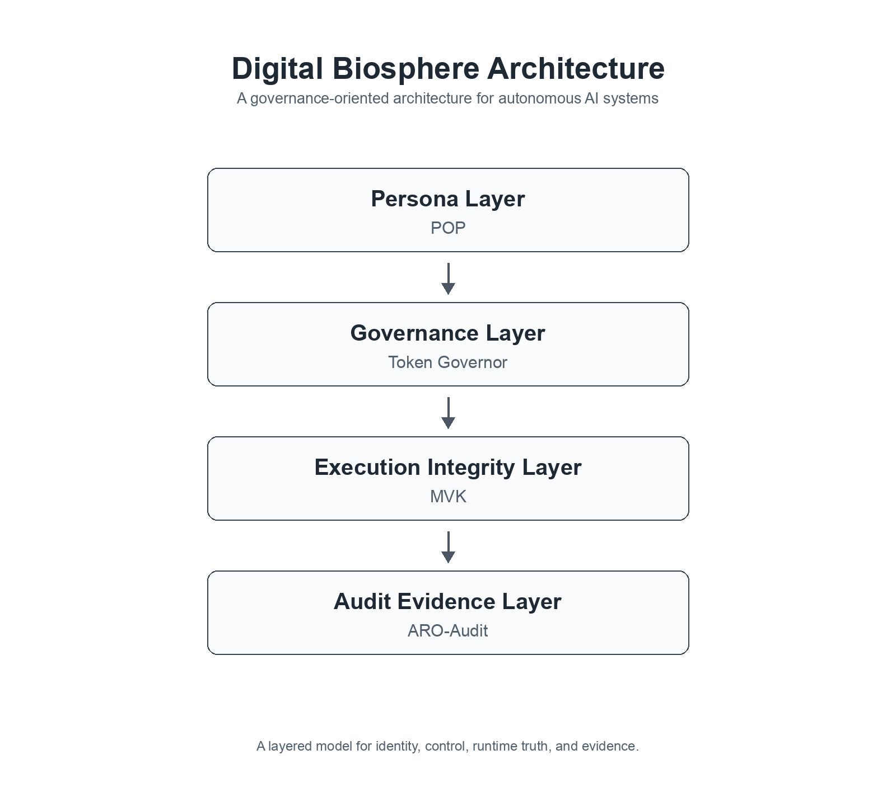
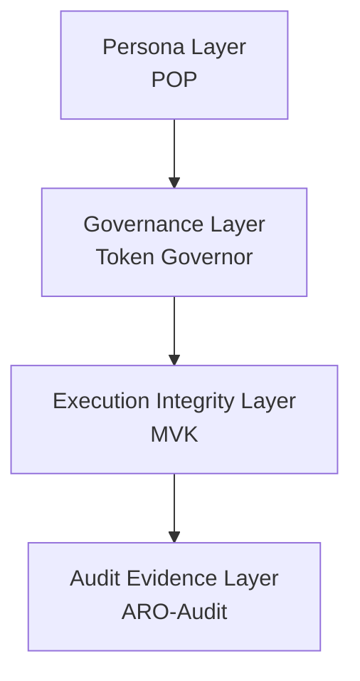

# Digital Biosphere Architecture

A governance-oriented architecture for autonomous AI systems

## Overview

Digital Biosphere Architecture is the parent architecture repository for a set
of core components that describe how autonomous AI systems carry identity,
accept governance constraints, preserve execution integrity, and emit audit
evidence.

It is not a monolithic agent framework. It exists as a narrative hub and
architecture hub that makes identity, governance, execution integrity, and
audit evidence legible as one coordinated stack.

Narrative spine: persona -> governance -> execution integrity -> audit evidence.

## Architecture Diagram

Static reference diagram for the four-layer architecture.

## Architecture at a Glance

## Core Layers

### Persona Layer

Portable persona objects and identity attachment.
This layer defines how a system carries a stable identity-facing object across
tools, runtimes, and interactions.

### Governance Layer

Policy, permissions, budget, and runtime constraints.
This layer decides what an autonomous system is allowed to do before behavior
is treated as acceptable or trusted.

### Execution Integrity Layer

What actually happened during execution.
This layer focuses on runtime truth, integrity checks, and minimal
verification surfaces for execution claims.

### Audit Evidence Layer

Evidence bundles, exportable records, and verifiable audit trails.
This layer turns execution-relevant activity into artifacts that can be
reviewed, exported, and referenced in governance workflows.

## Ecosystem Repositories

- POP — Persona Object Protocol ([joy7758/persona-object-protocol](https://github.com/joy7758/persona-object-protocol))
- Token Governor — runtime governance and token control ([joy7758/token-governor](https://github.com/joy7758/token-governor))
- MVK — execution integrity layer ([joy7758/fdo-kernel-mvk](https://github.com/joy7758/fdo-kernel-mvk))
- ARO-Audit — audit evidence and verification pipeline ([joy7758/aro-audit](https://github.com/joy7758/aro-audit))

## Design Intent

- separation of concerns
- composability
- verifiable operation
- architecture-first ecosystem alignment

## Documents

- [Architecture](docs/architecture.md)
- [Ecosystem Map](docs/ecosystem-map.md)

## Status

- early architecture hub
- working draft
- ecosystem alignment in progress
