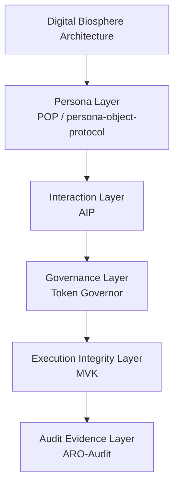

# Digital Biosphere Architecture

Digital Biosphere Architecture is a governance-oriented architecture for increasingly autonomous AI systems.

This repository is not a standalone agent framework. It is the narrative hub for a layered architecture that organizes the ecosystem into five canonical layers: Persona Layer, Interaction Layer, Governance Layer, Execution Integrity Layer, and Audit Evidence Layer.

For terminology and repository roles, use this repository as the canonical interpretive entry point for the broader ecosystem.

## Canonical Stack

Digital Biosphere Architecture

Layers:

1. **Persona Layer**
   Implementation: POP (persona-object-protocol)
2. **Interaction Layer**
   Implementation: AIP
3. **Governance Layer**
   Implementation: Token Governor
4. **Execution Integrity Layer**
   Implementation: MVK
5. **Audit Evidence Layer**
   Implementation: ARO-Audit

## Overview

The five-layer stack explains how autonomous AI systems can be read through:

- identity
- interaction
- governance
- execution integrity
- audit evidence

## Architecture Diagram

## Standard Entry Matrix

[docs/standard-entry-matrix.md](docs/standard-entry-matrix.md)

## FDO Proposal Entry

See [docs/fdo-profile-proposal-entry.md](docs/fdo-profile-proposal-entry.md)

## Terminology Alignment

See [docs/fdo-terminology-alignment.md](docs/fdo-terminology-alignment.md)

## Minimal FDO Crosswalk

See [docs/minimal-fdo-crosswalk.md](docs/minimal-fdo-crosswalk.md)

## Vienna Poster Talking Points

See [docs/vienna-poster-talking-points.md](docs/vienna-poster-talking-points.md)

## Vienna Scripts

- [60-Second Triple Script](docs/vienna/fdo-vienna-60s-triple-script.md)
- [3-Minute Triple Script](docs/vienna/fdo-vienna-3min-triple-script.md)
- [Rapid Q&A Triple](docs/vienna/fdo-vienna-rapid-qa-triple.md)

## Reference Implementations

### Persona Layer

https://github.com/joy7758/persona-object-protocol

### Governance Layer

https://github.com/joy7758/token-governor

### Execution Integrity Layer

https://github.com/joy7758/fdo-kernel-mvk

### Audit Evidence Layer

https://github.com/joy7758/aro-audit

## Repository Roles

| Repository | Role |
| --- | --- |
| [digital-biosphere-architecture](https://github.com/joy7758/digital-biosphere-architecture) | narrative hub and system overview |
| [persona-object-protocol](https://github.com/joy7758/persona-object-protocol) | persona layer |
| [agent-intent-protocol](https://github.com/joy7758/agent-intent-protocol) | interaction layer |
| [token-governor](https://github.com/joy7758/token-governor) | governance layer |
| [fdo-kernel-mvk](https://github.com/joy7758/fdo-kernel-mvk) | execution integrity reference for verifiable runtime evidence |
| [aro-audit](https://github.com/joy7758/aro-audit) | audit evidence layer |
| [verifiable-agent-demo](https://github.com/joy7758/verifiable-agent-demo) | end-to-end demonstration |

## Canonical Navigation

- [Canonical terms](docs/canonical-terms.md) for architecture vocabulary and repository-name distinctions.
- [Repository map](docs/repository-map.md) for repository roles, layer placement, and entry guidance.
- [Interaction Layer](docs/interaction-layer.md) for the interaction-layer rationale and boundaries.
- [Five-Layer Stack](docs/five-layer-stack.md) for the one-page stack summary.
- [Canonical Stack](#canonical-stack), [Repository Roles](#repository-roles), and [Layer Notes](#layer-notes) in this README for the main architecture overview.
- [Verifiable Agent Demo](https://github.com/joy7758/verifiable-agent-demo) for the smallest guided walkthrough across layers.

## Where to Start

- For the system view, stay in this repository.
- For the persona-layer entry point, go to [persona-object-protocol](https://github.com/joy7758/persona-object-protocol).
- For the interaction-layer draft, go to [agent-intent-protocol](https://github.com/joy7758/agent-intent-protocol).
- For the smallest cross-layer walkthrough, go to [verifiable-agent-demo](https://github.com/joy7758/verifiable-agent-demo).

## Why this stack exists

- Persona alone is not enough because identity does not declare task semantics or runtime requests.
- Interaction must remain separate because intent, action, and result objects should not be collapsed into persona objects or audit receipts.
- Governance must precede execution claims because runtime boundaries need to be explicit before behavior can be reviewed.
- Execution integrity matters because runtime claims need checkable evidence about what actually happened.
- Audit evidence must be exportable because outside reviewers need portable artifacts instead of internal-only assertions.

## Start in 5 Minutes

- [Verifiable Agent Demo](https://github.com/joy7758/verifiable-agent-demo) for a compact end-to-end walkthrough.
- [POP quick trial](https://github.com/joy7758/persona-object-protocol/blob/main/TRY_POP.md) for a minimal persona-layer entry point.
- [Agent Intent Protocol](https://github.com/joy7758/agent-intent-protocol) for the interaction-layer draft.
- [Token Governor](https://github.com/joy7758/token-governor) for runtime governance and budget-policy control.
- [ARO-Audit quick demo](https://github.com/joy7758/aro-audit/blob/main/docs/demos/execution-receipt-demo.md) for evidence-oriented outputs.

## Layer Notes

### Persona Layer

Portable persona objects and identity attachment across tools, runtimes, and interactions.

### Interaction Layer

Machine-readable intent, action, and result objects for agent-to-agent and agent-to-runtime coordination.

### Governance Layer

Policy, permissions, budget, and runtime constraints that determine what a system is allowed to do.

### Execution Integrity Layer

Runtime truth, integrity checks, and minimal verification surfaces for execution claims. MVK belongs here as execution integrity work, not as a separate parallel architecture axis.

### Audit Evidence Layer

Evidence bundles, exportable records, and reviewable audit artifacts for governance and conformance workflows.

## Current Hardening Priorities

- [Threat model](https://github.com/joy7758/aro-audit/blob/main/docs/threat-model.md)
- [Conformance vectors](https://github.com/joy7758/aro-audit/blob/main/docs/conformance-vectors-rc1-plus.md)
- [Shortest validation loop](https://github.com/joy7758/verifiable-agent-demo/blob/main/docs/shortest-validation-loop.md)
- [Layer positioning](docs/runtime-positioning.md)

## Architecture Whitepaper

Download:
[docs/governance_architecture_whitepaper.pdf](docs/governance_architecture_whitepaper.pdf)

## Citation

Suggested citation:

`joy7758. Governance Architecture for Autonomous AI Agents: Digital Biosphere Architecture Whitepaper. GitHub, 2026.`

## Documents

- [Architecture](docs/architecture.md)
- [Interaction Layer](docs/interaction-layer.md)
- [Five-Layer Stack](docs/five-layer-stack.md)
- [Governance Architecture Whitepaper](docs/governance_architecture_whitepaper.md)
- [Community Discussion Summary](docs/community_discussion_summary.md)
- [Ecosystem Map](docs/ecosystem-map.md)
- [Architecture Map](docs/architecture-map.md)
- [Core Objects](docs/core-objects.md)
- [Runtime Positioning](docs/runtime-positioning.md)
- [Standards Hardening Roadmap](docs/standards-hardening-roadmap.md)
- [One-Page Brief](docs/one-page-brief.md)

## Status

- narrative hub for the canonical five-layer architecture stack
- working draft
- ecosystem alignment in progress
<!-- render-refresh: 20260311T205242Z -->
