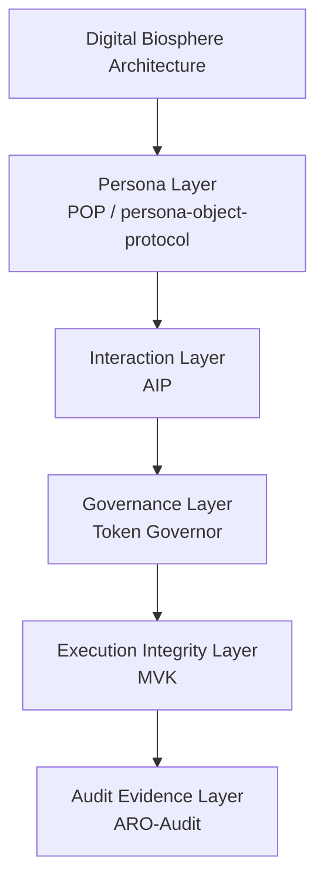

<!-- language-switch:start -->
[English](./README.md) | [中文](./README.zh-CN.md)
<!-- language-switch:end -->

# 数字生物圈架构

数字生物圈架构是一种面向治理的架构，适用于日益自治的人工智能系统。

该仓库不是独立的代理框架。它是分层架构的叙述中心，将生态系统组织为五个规范层：角色层、交互层、治理层、执行完整性层和审计证据层。

对于术语和仓库角色，请使用此仓库作为更广泛的生态系统的规范解释入口点。

## 规范堆栈

数字生物圈架构

层数：

1. **角色层**
实现：POP（角色对象协议）
2. **交互层**
实施：AIP
3. **治理层**
实施：代币调控器
4. **执行完整性层**
实施：MVK
5. **审计证据层**
实施：ARO 审计

## 概述

五层堆栈解释了如何解读自主人工智能系统：

- 身份
- 相互作用
- 治理
- 执行完整性
- 审计证据

## 架构图

## 标准输入矩阵

[文档/standard-entry-matrix.md](docs/standard-entry-matrix.md)

## FDO提案输入

请参阅 [docs/fdo-profile-proposal-entry.md](docs/fdo-profile-proposal-entry.md)

## 术语对齐

请参阅 [docs/fdo-terminology-alignment.md](docs/fdo-terminology-alignment.md)

## 最小 FDO 人行横道

请参阅[docs/minimal-fdo-crosswalk.md](docs/minimal-fdo-crosswalk.md)

## 执行证据层位置

请参阅[docs/execution-evidence-layer-position.md](docs/execution-evidence-layer-position.md)

## 维也纳海报谈话要点

请参阅 [docs/vienna-poster-talking-points.md](docs/vienna-poster-talking-points.md)

## 维也纳脚本

- [60秒三重脚本](docs/vienna/fdo-vienna-60s-triple-script.md)
- [3分钟三重脚本](docs/vienna/fdo-vienna-3min-triple-script.md)
- [快速问答三重](docs/vienna/fdo-vienna-rapid-qa-triple.md)

## 参考实现

### 角色层

https://github.com/joy7758/persona-object-protocol

### 治理层

https://github.com/joy7758/token-governor

### 执行完整性层

https://github.com/joy7758/fdo-kernel-mvk

### 审计证据层

https://github.com/joy7758/aro-audit

## 仓库角色

|仓库 |角色 |
| --- | --- |
| [数字生物圈架构](https://github.com/joy7758/digital-biosphere-architecture) |叙事中心和系统概述|
| [角色对象协议](https://github.com/joy7758/persona-object-protocol) |角色层|
| [智能体意图协议](https://github.com/joy7758/agent-intent-protocol) |交互层 |
| [代币调控者](https://github.com/joy7758/token-governor) |治理层|
| [fdo-kernel-mvk](https://github.com/joy7758/fdo-kernel-mvk) |可验证运行时证据的执行完整性参考 |
| [aro-审计](https://github.com/joy7758/aro-audit) |审计证据层|
| [可验证代理演示](https://github.com/joy7758/verifiable-agent-demo) |端到端演示|

## 规范导航

- [规范术语](docs/canonical-terms.md) 用于架构词汇和仓库名称区别。
- [仓库地图](docs/repository-map.md) 用于仓库角色、图层放置和条目指导。
- [交互层](docs/interaction-layer.md) 交互层的基本原理和边界。
- [五层堆栈](docs/five-layer-stack.md) 用于一页堆栈摘要。
- 本 README 中的 [Canonical Stack](#canonical-stack)、[Repository Roles](#repository-roles) 和 [Layer Notes](#layer-notes) 提供了主要架构概述。
- [可验证代理演示](https://github.com/joy7758/verifiable-agent-demo) 用于跨层的最小引导演练。

## 从哪里开始

- 对于系统视图，请留在此仓库中。
- 对于角色层入口点，请转至 [角色对象协议](https://github.com/joy7758/persona-object-protocol)。
- 对于交互层草案，请转至 [agent-intent-protocol](https://github.com/joy7758/agent-intent-protocol)。
- 对于最小的跨层演练，请转至 [可验证代理演示](https://github.com/joy7758/verifiable-agent-demo)。

## 为什么这个堆栈存在

- 仅角色是不够的，因为身份不声明任务语义或运行时请求。
- 交互必须保持分离，因为意图、操作和结果对象不应折叠为角色对象或审计回执。
- 治理必须先于执行声明，因为在审查行为之前需要明确运行时边界。
- 执行完整性很重要，因为运行时声明需要有关实际发生情况的可检查证据。
- 审计证据必须是可导出的，因为外部审核者需要可移植的工件，而不是仅限内部的断言。

## 5 分钟后开始

- [可验证代理演示](https://github.com/joy7758/verifiable-agent-demo) 用于紧凑的端到端演练。
- [POP 快速试用](https://github.com/joy7758/persona-object-protocol/blob/main/TRY_POP.md) 用于最小角色层入口点。
- [智能体意图协议](https://github.com/joy7758/agent-intent-protocol)交互层草案。
- [Token Governor](https://github.com/joy7758/token-governor) 用于运行时治理和预算策略控制。
- [ARO-Audit 快速演示](https://github.com/joy7758/aro-audit/blob/main/docs/demos/execution-receipt-demo.md) 用于以证据为导向的输出。

## 图层注释

### 角色层

跨工具、运行时和交互的可移植角色对象和身份附件。

### 交互层

用于代理到代理和代理到运行时协调的机器可读意图、操作和结果对象。

### 治理层

决定允许系统执行哪些操作的策略、权限、预算和运行时约束。

### 执行完整性层

运行时真相、完整性检查和执行声明的最小验证面。 MVK 在这里属于执行完整性工作，而不是作为单独的并行架构轴。

### 审计证据层

用于治理和一致性工作流程的证据包、可导出记录和可审查的审计工件。

## 当前的强化优先事项

- [威胁模型](https://github.com/joy7758/aro-audit/blob/main/docs/threat-model.md)
- [一致性向量](https://github.com/joy7758/aro-audit/blob/main/docs/conformance-vectors-rc1-plus.md)
- [最短验证循环](https://github.com/joy7758/verifiable-agent-demo/blob/main/docs/shortest-validation-loop.md)
- [图层定位](docs/runtime-positioning.md)

## 架构白皮书

下载：
[docs/governance_architecture_whitepaper.pdf](docs/governance_architecture_whitepaper.pdf)

## 引文

建议引用：

`joy7758. Governance Architecture for Autonomous AI Agents: Digital Biosphere Architecture Whitepaper. GitHub, 2026.`

## 文件

- [架构](docs/architecture.md)
- [交互层](docs/interaction-layer.md)
- [五层堆叠](docs/five-layer-stack.md)
- [治理架构白皮书](docs/governance_architecture_whitepaper.md)
- [社区讨论总结](docs/community_discussion_summary.md)
- [生态系统地图](docs/ecosystem-map.md)
- [架构图](docs/architecture-map.md)
- [核心对象](docs/core-objects.md)
- [运行时定位](docs/runtime-positioning.md)
- [标准强化路线图](docs/standards-hardening-roadmap.md)
- [一页简介](docs/one-page-brief.md)

## 地位

- 规范五层架构堆栈的叙事中心
- 工作草案
- 生态系统调整正在进行中
<!-- render-refresh: 20260311T205242Z -->
