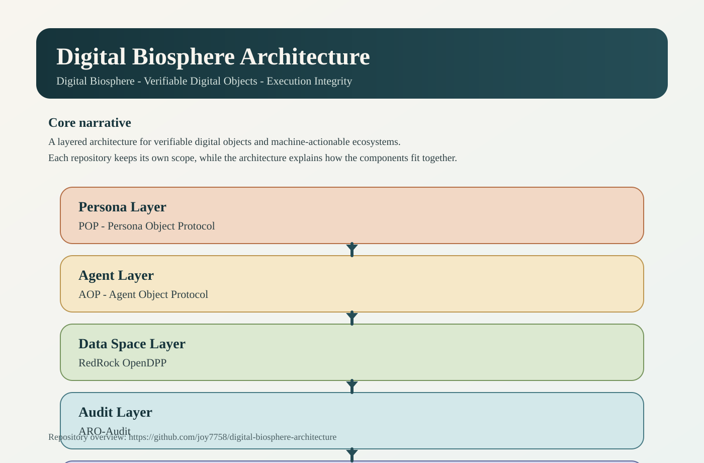

# Architecture

The Digital Biosphere groups related repositories into a small layered model:

1. Persona Layer: POP
2. Agent Layer: AOP
3. Data Space Layer: RedRock OpenDPP
4. Audit Layer: ARO-Audit
5. Proof Kernel: MVK

The architecture repository exists to explain how these repositories relate to
each other without changing their individual scopes.
