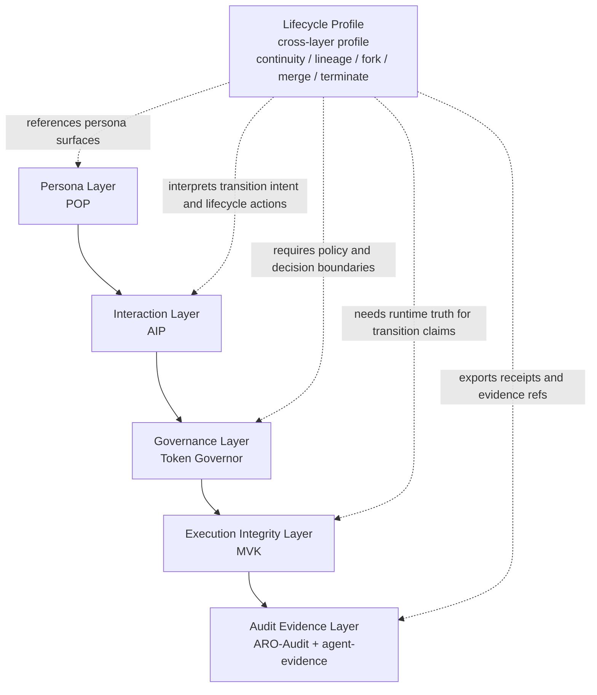

# Canonical Stack and Lifecycle Profile

Digital Biosphere Architecture keeps the canonical five-layer stack unchanged:

1. Persona
2. Interaction
3. Governance
4. Execution Integrity
5. Audit Evidence

Lifecycle Profile is not a sixth layer. It is a cross-layer profile that adds
minimal continuity semantics for autonomous agent instances:

- continuity
- lineage
- fork
- merge
- terminate

This profile is meant to make lifecycle transitions reviewable and reusable
without collapsing the rest of the architecture into one protocol.

## Why the five-layer stack stays unchanged

The five-layer stack is the main reading order for the architecture:

- Persona says which portable identity surface is attached.
- Interaction says what request, action, or result is being exchanged.
- Governance says what is allowed.
- Execution Integrity says what actually happened.
- Audit Evidence says what can be exported and reviewed later.

Lifecycle semantics cut across that reading order. They do not replace it.
Adding a new main layer for lifecycle would blur the difference between
identity, policy, runtime truth, and audit artifacts. The better architectural
position is a cross-layer profile that depends on the existing layers.

## Why lifecycle does not belong inside POP

POP is about portable persona attachment and identity-facing objects. Lifecycle
governance asks a different question: what continuity and state transitions are
allowed for a governed agent instance over time?

That difference matters:

- persona portability is not the same as lifecycle continuity
- persona attachment does not define fork, merge, or terminate semantics
- lineage decisions may depend on governance, runtime evidence, and audit
  receipts, not only on persona state

Lifecycle therefore should reference persona surfaces, but should not be
collapsed into POP itself.

## Why lifecycle is not the same as audit evidence

Audit evidence records what can be exported, checked, and reviewed. Lifecycle
semantics define what a transition means.

Those two concerns are connected but not identical:

- audit can preserve lifecycle receipts
- audit can verify whether a receipt was tampered with
- audit does not by itself define whether a fork, merge, or terminate event is
  valid under governance policy

Lifecycle Profile therefore sits above the layers as a semantic profile, while
Audit Evidence remains the layer that packages reviewable artifacts.

## Lifecycle Profile boundary

Lifecycle Profile is responsible for:

- continuity semantics for governed agent instances
- lineage semantics across branch, fork, and merge events
- minimal state labels and transition labels
- references to governance decisions and runtime evidence
- reviewable lifecycle receipts that can later be audited

Lifecycle Profile is not responsible for:

- persona metaphysics or personhood claims
- replacing POP, AIP, Token Governor, MVK, ARO-Audit, or agent-evidence
- defining the whole runtime model of an agent system
- declaring tamper-proof finality by itself

## Minimal state semantics

The minimal lifecycle state surface in v0.1 is:

| State | Meaning |
| --- | --- |
| `BORN` | instance has been initialized but is not yet actively operating |
| `ACTIVE` | instance is allowed to act within governance constraints |
| `SUSPENDED` | instance exists but is temporarily paused or blocked |
| `MERGED` | instance has been absorbed into another governed branch and should not continue independently |
| `TERMINATED` | instance has been ended and should not resume |

These are governance continuity states, not metaphysical claims about whether
an AI system is alive.

## Minimal transition semantics

The minimal transition surface in v0.1 is:

| Transition | Minimal meaning |
| --- | --- |
| `init` | create a lifecycle object in `BORN` |
| `activate` | move `BORN` to `ACTIVE` |
| `suspend` | move `ACTIVE` to `SUSPENDED` |
| `resume` | move `SUSPENDED` to `ACTIVE` |
| `fork` | create a new governed branch with lineage continuity and a reviewable receipt |
| `merge` | absorb one branch into another and mark the merged branch as `MERGED` |
| `terminate` | end the branch and mark it as `TERMINATED` |

In this profile, `merge` and `terminate` are terminal outcomes for the subject
instance. They are not ordinary trace events. They are governance continuity
events that should be backed by evidence and receipts.

## Relationship to the canonical stack

The diagram shows the intended placement: Lifecycle Profile sits above the
stack as a profile. It depends on all five layers, but it does not replace any
of them and it does not become a new canonical layer.

## Repository mapping

| Repository | Role in Lifecycle Profile |
| --- | --- |
| `persona-object-protocol` | source of persona-facing references and attachment surfaces |
| `agent-intent-protocol` | interaction objects that may carry lifecycle-related requests or actions |
| `token-governor` | governance profile references, policy checks, and decision boundaries |
| `fdo-kernel-mvk` | execution-integrity surface for whether transition-relevant runtime facts actually occurred |
| `aro-audit` | bounded receipts, conformance vectors, and audit-facing review surface |
| `agent-evidence` | runtime evidence bundles and evidence references attached to lifecycle receipts |
| `agent-object-protocol` | minimal Lifecycle Object / Lifecycle Receipt / Lifecycle Profile v0.1 specimen |
| `verifiable-agent-demo` | smallest end-to-end lifecycle walkthrough across the profile surfaces |

## What this profile claims, and what it does not

This profile claims only a minimal governance continuity surface for autonomous
agent instances.

It does not claim:

- that AI systems are persons
- that lifecycle semantics settle identity philosophy
- that a lifecycle receipt alone proves tamper-proof finality
- that the profile is already a full ecosystem standard

The purpose of this profile is narrower: make continuity, lineage, fork,
merge, and terminate semantics portable enough to review, verify, and discuss
across repositories.
